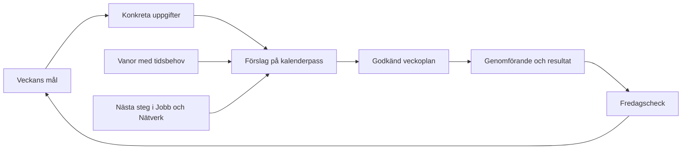

# Förslag: sammanhängande flöden i Veckoverket

Status: ursprungligt förslag för granskning. De tre valda flödena har därefter genomförts lokalt; se [granskningsbeskrivningen](connected-week-review.md). Ingen publicering har gjorts. Underlag: kodgenomgång av den befintliga lösningen. Livekonton, externa API:er och personliga produktionsdata har inte granskats.

## Produktbeslut

Veckovyn blir arbetsytan där användaren ser vad veckans mål kräver, när arbetet ska göras och vad som återstår. Jobb och Nätverk behåller sina detaljvyer och den befintliga navigationen.

## Vad kodgenomgången visar

1. **Vanorna har egen avbockning.** `habits.ts` räknar datum i `checks`. Kalenderpassen saknar en identitet som kopplar dem till en vana. Placeringen bredvid kalendern ger därför ingen verksamhetskoppling.
2. **Veckomål skapar uppgifter, men uppgifterna blir inte egna kalenderreservationer.** Målformuläret tar emot mål, kategori och uppgiftstext. Uppgifterna saknar tidsestimat och en direkt passkoppling.
3. **Planeringen utgår huvudsakligen från kategoriernas tidsmål.** `linkedPlan` och automatisk planering kan sätta `goalId` till det första målet i samma kategori och vecka. Det kan ge ett mål planerad tid utan att passet motsvarar dess konkreta uppgift, särskilt när flera mål har samma kategori.
4. **Jobb och Nätverk har redan stabilare handlingsflöden.** Nästa steg kan bokas, ett befintligt pass öppnas och genomförande skiljs från att själva nästa steget är klart. Den logiken bör återanvändas.
5. **Måndags- och fredagscheckarna sparar anteckningar och visar mål.** De gör ännu inte anteckningarna till en strukturerad plan respektive en strukturerad överföring av kvarvarande arbete.
6. **Datum har flera avsiktliga sammanhang.** Kalendern använder vald vecka; Jobb och Nätverk har bland annat filtret ”Kommande sju dagar”. Lägg till en tydlig koppling till vald vecka utan att ändra innebörden av de befintliga filtren.

Kodreferenser: `src/lib/habits.ts`, `src/components/goals.tsx`, `src/lib/planner.ts`, `src/lib/auto-planning.ts`, `src/components/workspace.tsx`, `src/lib/action-workflow.ts`, `src/components/weekly-routine.tsx`.

## Bedömning ur de fyra rollerna

| Perspektiv | Prioritering | Konsekvens i lösningen |
| --- | --- | --- |
| Senior produktägare | Veckomål ska gå att genomföra inom verklig kapacitet. | Mål får konkreta uppgifter, tidsbehov och ett tydligt planeringsläge. |
| Senior UX-ingenjör | Användaren ska kunna följa samma arbete mellan vyerna. | Visa källa, nästa handling och länk till samma bokning. Återanvänd bokningsflödet. |
| Senior utvecklare | Kopplingarna ska bygga på identiteter och tåla omplanering. | Komplettera befintliga referenser med uppgifts- och vanukopplingar; härled status från sparade poster. |
| Försäljningschef | Visa vad insatsen leder till. | Följ inskickade ansökningar, relevanta samtal och avklarade åtaganden tillsammans med nedlagd tid. Produktvärdet blir ”från veckomål till genomfört resultat”. |

## 1. Realisera veckans jobbmål i veckovyn

Exempel: **”Skicka två genomarbetade ansökningar denna vecka.”**

1. Välj eller skapa veckomålet i veckovyn eller måndagschecken.
2. Bryt ned det i konkreta uppgifter: anpassa material till tjänst A, färdigställa och skicka A, motsvarande arbete för B.
3. Ange tidsbehov och eventuellt sista datum. Knyt till en befintlig ansökan/nästa steg där sådan redan finns, så att samma arbete inte skapas en gång till.
4. **Föreslå pass** visar var uppgifterna ryms i den valda veckan. Framtida genererade, obundna block kan användas för de konkreta uppgifterna. Manuella, importerade, låsta och genomförda pass skyddas.
5. **Lägg in i veckan** tillämpar det granskade förslaget. Om något inte ryms syns det kvar som ”Behöver planeras”, med orsak.
6. Kalenderpasset visar uppgift och tillhörande mål. Målkortet öppnar det bokade passet.
7. Uppföljningen skiljer på bokad tid, genomförd tid och faktiskt resultat. Ett genomfört skrivpass innebär inte automatiskt att en ansökan är skickad.

Högerspalten på desktop får **Veckans mål** över **Vanor**. Ett målkort kan till exempel visa: ”2 ansökningar · 1 skickad · 3 arbetspass bokade · 1 uppgift behöver planeras”. Samma innehåll visas i mobilens veckovy i kompakt form.

## 2. Koppla vanor till veckan

- En vana kan vara utan tidsreservation eller ha ett tidsbehov, exempelvis ”30 min rörelse”.
- För bestämda veckodagar visas de planerade tillfällena. För ”tre dagar i veckan” väljer användaren dagar i planeringsförslaget.
- **Boka i veckan** återanvänder samma bokningsflöde som andra uppgifter. Upprepad planering öppnar eller kompletterar befintliga pass och skapar inga dubbletter.
- Kalenderpasset får en riktig vanukoppling. Att markera det genomfört räknas i vanomatrisen. Två genomförda pass samma dag ger fortfarande en avklarad vanodag.
- Manuella avbockningar och genomföranden från kalendern hålls isär som källor. En manuell avbockning registrerar inte automatiskt genomförda kalenderminuter.
- En avbockning som kommer från kalendern visar vilket pass den kommer från. Ångra via den källan; en ändring av ett pass får inte radera en separat manuell avbockning.
- Vanor utan tidsreservation visas som dagens vanor, utanför kalenderns tidsaxel. De kan bockas av utan att ett tidsblock skapas.
- Paus stoppar nya planeringsförslag. Historik och redan sparade bokningar bevaras.

## 3. Genomgång av övriga processer

| Process | Föreslagen sammanhängande väg |
| --- | --- |
| Start och inställningar | Välj tillgänglig tid och veckans prioriteringar. Kategoriernas timmål fungerar som planeringsramar. |
| Långsiktigt mål | Välj veckans delmål, koppla konkreta uppgifter och planera dem i kalendern. |
| Jobbansökan | Ansökan → nästa steg med datum → bokat pass → genomfört arbete → bekräftat resultat/nästa steg. |
| Kontakt | Loggat samtal/mejl → överenskommelse eller bevakning → uppföljningsdatum → samma kalenderbokning → ny logghändelse. |
| Deadline | Deadline → konkreta delsteg och tidsbehov → kalenderpass före deadline → tydligt kvarvarande arbete. |
| Manuell bokning och dragmarkering | Skapa pass och välj vid behov befintlig uppgift, vana eller nästa steg som källa. Kopplingen följer med när passet flyttas. |
| Automatisk planering | Prioriterade uppgifter och åtaganden först; återstående tillgänglig tid kan fyllas enligt kategoriinställningar. Visa förslag och kapacitetsbrist. |
| Måndagscheck | Välj veckans mål → kontrollera återstående åtaganden och vanor → granska kapacitet → tillämpa veckoplanen. |
| Dagligt genomförande | Öppna bokningen, se varför den finns, registrera genomförande och vid behov utfallet. |
| Missat pass | Visa vad som fortfarande behöver göras, välj ny tid och behåll länken till det ursprungliga arbetet. |
| Fredagscheck | Samla målutfall, vanor och kvarvarande arbete. Välj vad som ska avslutas, omplaneras eller tas vidare till nästa vecka. |
| Reflektion och statistik | Läs samma sparade genomförande och resultat. Håll timmar och uppnådda mål åtskilda. |
| Inspelning och AI | Granskad sammanfattning → godkända nästa steg → befintlig uppföljnings-/bokningsprocess. Visa fel och återförsök i inspelningsflödet. |
| Google/iCal | Importerade bokningar begränsar kapaciteten. Lokala omplaneringar behåller ursprung och källkopplingar. |
| Synk, ångra och säkerhetskopia | Spara samma källidentiteter, manuella markeringar och relationer. Konflikter får inte skapa nya kopior av samma arbete. |

## Gemensamma regler

- Samma valda vecka används i veckans mål, vanor, planeringsförslag och veckocheckar. Jobb/Nätverk får en uttrycklig väg till arbetet i vald vecka.
- Kalenderpass har källreferenser. Titel- eller kategorimatchning ska inte bestämma vilken konkret uppgift passet hör till.
- Visa ”Behöver planeras”, ”Bokat”, ”Genomfört” och ”Behöver följas upp” där de är relevanta. ”Väntar på svar” behåller sin särskilda innebörd.
- En gemensam uppmärksamhetslista visar kvarvarande uppgifter, passerade bevakningar och missade åtaganden med orsak och nästa handling. Tomma grupper döljs.
- Ett bokat nästa steg öppnar sin befintliga bokning. En flytt ändrar inte arbetets identitet.
- Överföring till nästa vecka behåller historiken. En daterad uppgift som hör till ett äldre mål ska ändå synas i den vecka där arbetet är planerat.
- Veckans slutliga uppföljning behöver en daterad sammanfattning, så att senare slutfört arbete inte skriver om den tidigare veckans rapporterade utfall.

## Rekommenderad genomförandeordning

**Etapp 1 – Veckomål och vanor blir genomförbara**

- Tidsbehov och källkoppling för måluppgifter.
- Planeringsförslag för veckans jobbmål, med tydlig kapacitetskontroll.
- Koppling mellan vanor och kalenderpass samt sammanhållen avbockning.
- Veckans mål och vanor i högerspalten; samma innehåll på mobil.

**Etapp 2 – Slut hela veckoloopen**

- Måndagschecken hjälper användaren att faktiskt skapa planen.
- Fredagschecken avslutar veckan och överför kvarvarande arbete efter val.
- Samlad uppmärksamhetslista och konsekvent hantering av genomförande/utfall.

**Etapp 3 – Samordna alla ingångar och uppföljningen**

- Samma källkopplingar från Jobb, Nätverk, deadlines, inspelning och manuell bokning.
- Gemensam resultatuppföljning och kontroll av import, synk, ångra och historik för de nya relationerna.

## Godkännandekriterier för första etappen

1. Ett veckomål med flera uppgifter blir identifierbara kalenderpass, även om andra mål har samma kategori.
2. Upprepad tillämpning skapar inga dubbletter.
3. Otillräcklig tid lämnar arbete synligt och obokat; skyddade bokningar ändras inte.
4. Ett genomfört vanepass räknas en gång för rätt dag och vecka, med manuell avbockning bevarad.
5. Flyttade pass behåller uppgift, vana och mål. Flytt mellan veckor ger rätt veckouppföljning.
6. Ett genomfört pass för en ansökan förväxlas inte med ett inskickat resultat.
7. Ångra, omladdning, säkerhetskopia och synk behåller relationer och historik.
8. Flödet fungerar med mus, pekskärm och tangentbord på desktop och mobil.

## Föreslagna mått på nytta

- Andel av veckans prioriterade uppgifter som har avsatt tid.
- Tid från skapat veckomål till första bokade konkreta uppgift.
- Andel nästa steg med tydligt datum och ansvar.
- Faktiska utfall: inskickade ansökningar, genomförda relevanta samtal och slutförda åtaganden.
- Kvarvarande arbete vid veckoslut och hur mycket som förs vidare.

Inga nya mätvärden samlas in i denna genomgång. Måtten ovan är förslag för produktens egen uppföljning.
